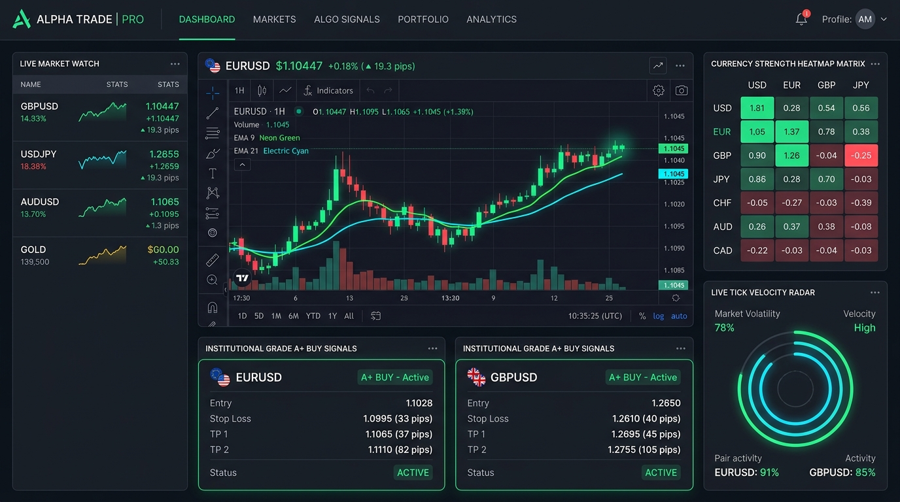
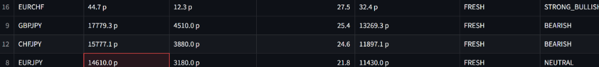

# 🏛️ Institutional Forex Strategy & Live Scalper Analyser (v3.0)

<div align="center">

[](https://share.streamlit.io/karidasd/forex-institutional-scalper/main/dashboard.py)
[](https://www.python.org/)
[](https://www.metatrader5.com/)
[](LICENSE)
[]()

### 🌐 **[👉 CLICK HERE TO OPEN LIVE DASHBOARD 👈](https://share.streamlit.io/karidasd/forex-institutional-scalper/main/dashboard.py)**

*A 24/7 real-time quantitative Forex intelligence scanner, institutional confluence engine, and sub-second M1/M5 Live Scalper.*

</div>

---

## 📸 Dashboard Previews

### 1. 🎯 Institutional Day-Trade & Scalping Overview


### 2. ⚡ Live M1/M5 Scalper Radar & TradingView Pro Chart


---

## 🌟 Key Features

### 1. ⚡ Live Precision Scalper Radar (M1 / M5 Sniper v3.0)
* **6-Gate Quantitative Filter Pipeline:**
  1. `Gate 0`: **Economic News Shield** (automatically pauses $\pm 15$ min around Red Folder events).
  2. `Gate 1`: **Execution Spread Cost Gate** (spread must be $\le 16\%$ of M5 ATR).
  3. `Gate 2 & 3`: **M5 Trend & Non-Chop Regime** (Wilder ADX $\ge 22.0$ + EMA 9/21 stack + slope).
  4. `Gate 4 & 5`: **M1 Displacement & Volume Surge** (confirmed candle body $\ge 0.85\times$ ATR + volume $\ge 1.75\times$ avg).
  5. `Gate 5.5`: **M1 Order Flow Filter** (rejects dead chop/squeeze, rewards liquidity surges).
  6. `Gate 6`: **Clean Air Room-to-Run** ($\ge 1.8\times$ SL distance to nearest D1/W1 support/resistance wall).
* **Dynamic Per-Pair ATR Stop Losses:** Pip clamping tailored for JPY crosses, Majors, and Gold.
* **Hybrid Break-Even Execution Roadmap:** Visual step-by-step roadmap (`Entry ➔ BE Lock ➔ TP1 ➔ TP2`).

---

### 2. 🧭 Triple HTF Trend Alignment (D1 + H4 + H1)
* Real-time multi-timeframe consensus evaluating **Daily (D1)** macro trend, **4-Hour (H4)** swing structure, and **1-Hour (H1)** intraday momentum.
* **Triple Alignment Bonus:** Awards maximum $+20$ points when all 3 timeframes agree (`D1 🟢 | H4 🟢 | H1 🟢`) and heavily penalizes counter-trend traps.

---

### 3. 🛡️ High-Impact Economic News Shield
* Live automated economic calendar feed.
* Automatically shields and flags pairs during high-volatility releases (CPI, Non-Farm Payrolls, FOMC, Interest Rate decisions).

---

### 4. 🎯 Institutional Position Size Calculator
* Real-time risk management calculator located in the sidebar.
* Computes exact broker Lot Sizes, Pip Values, and total € risked per trade based on account balance and risk % (e.g. 1.0%).

---

### 5. 🌊 M1 Order Flow & Tick Velocity Radar
* Sub-second order flow micro-heatmap measuring:
  * **Tick Velocity Ratio** (volume vs 10-bar moving average).
  * **Displacement Intensity** relative to ATR.
  * **Micro-Delta Flow** (Buyer vs Seller dominance percentage).

---

### 6. 📊 Currency Strength Matrix (CSM) & Daily ADR Profiler
* **Currency Strength Matrix:** Scores all 8 major global currencies (`EUR`, `USD`, `GBP`, `JPY`, `AUD`, `CAD`, `CHF`, `NZD`) from $-10$ to $+10$.
* **ADR (Average Daily Range) Tracker:** 14-day ADR exhaustion monitoring. Warns if daily movement capacity is exhausted ($>75\%$).

---

## 🚀 Quick Start & Installation

### Option 1: 24/7 Cloud Web Dashboard (No Install Needed)

👉 **Access the Live Web App:** **[Launch Live Dashboard](https://share.streamlit.io/karidasd/forex-institutional-scalper/main/dashboard.py)**

---

### Option 2: Local Machine (Windows + MT5)

1. **Clone the repository:**
   ```bash
   git clone https://github.com/karidasd/forex-institutional-scalper.git
   cd forex-institutional-scalper
   ```

2. **Install dependencies:**
   ```bash
   pip install -r requirements.txt
   ```

3. **Launch the Web Dashboard:**
   ```bash
   streamlit run dashboard.py
   ```
   *or simply double-click `START_DASHBOARD.bat`*

4. **Run Terminal Console Scanner:**
   ```bash
   python main.py --scan
   ```
   *or double-click `START_ANALYSER.bat`*

---

## 📁 File Structure

```text
STRATEGY_ANALYSER/
│
├── config.py                 # Target symbols, sessions, weights, risk settings
├── data_provider.py          # Thread-safe MT5 data pipeline with cloud yfinance fallback
├── scalper_engine.py         # M1/M5 Sniper Scalper (6 Quantitative Gates)
├── recommendation_engine.py  # M15/H1 Institutional Confluence Engine
├── market_profiler.py        # Currency Strength Matrix, ADR tracker & D1/H4/H1 Trend
├── confluence_scanner.py     # Liquidity sweeps, Session VWAP, CHoCH, FVGs, RSI divergence
├── news_shield.py            # High-Impact Economic News calendar filter
├── order_flow_radar.py       # M1 order flow velocity & micro-delta heatmap
├── position_sizer.py         # Dynamic risk-adjusted lot sizing module
├── dashboard.py              # Interactive Streamlit Web UI with TradingView Pro Charts
├── backtester.py             # Multi-strategy institutional backtesting engine
├── main.py                   # Main CLI entry point
├── START_DASHBOARD.bat       # 1-Click Dashboard launcher (Windows)
├── START_ANALYSER.bat        # 1-Click CLI launcher (Windows)
├── requirements.txt          # Cross-platform Python dependencies
├── assets/                   # Screenshots, banners, and visual assets
└── README.md                 # System documentation
```

---

## ⚠️ Disclaimer

*This software is for analytical, research, and educational purposes only. Forex and leveraged trading involves substantial risk of loss. Always test strategies thoroughly on demo accounts before considering live execution.*

---

## 📄 License

Distributed under the MIT License. See `LICENSE` for more information.

---

## 📸 Dashboard Previews

### 1. 🎯 Institutional Day-Trade & Scalping Overview


### 2. ⚡ Live M1/M5 Scalper Radar & TradingView Pro Chart


---

## 🌟 Key Features

### 1. ⚡ Live Precision Scalper Radar (M1 / M5 Sniper v3.0)
* **6-Gate Quantitative Filter Pipeline:**
  1. `Gate 0`: **Economic News Shield** (automatically pauses $\pm 15$ min around Red Folder events).
  2. `Gate 1`: **Execution Spread Cost Gate** (spread must be $\le 16\%$ of M5 ATR).
  3. `Gate 2 & 3`: **M5 Trend & Non-Chop Regime** (Wilder ADX $\ge 22.0$ + EMA 9/21 stack + slope).
  4. `Gate 4 & 5`: **M1 Displacement & Volume Surge** (confirmed candle body $\ge 0.85\times$ ATR + volume $\ge 1.75\times$ avg).
  5. `Gate 5.5`: **M1 Order Flow Filter** (rejects dead chop/squeeze, rewards liquidity surges).
  6. `Gate 6`: **Clean Air Room-to-Run** ($\ge 1.8\times$ SL distance to nearest D1/W1 support/resistance wall).
* **Dynamic Per-Pair ATR Stop Losses:** Dynamic pip clamping tailored for JPY crosses, Majors, and Gold.
* **Hybrid Break-Even Execution Roadmap:** Clear step-by-step roadmap (`Entry ➔ BE Lock ➔ TP1 ➔ TP2`).

---

### 2. 🧭 Triple HTF Trend Alignment (D1 + H4 + H1)
* Real-time multi-timeframe consensus evaluating **Daily (D1)** macro trend, **4-Hour (H4)** swing structure, and **1-Hour (H1)** intraday momentum.
* **Triple Alignment Bonus:** Awards maximum $+20$ points when all 3 timeframes agree (`D1 🟢 | H4 🟢 | H1 🟢`) and heavily penalizes counter-trend traps.

---

### 3. 🛡️ High-Impact Economic News Shield
* Live automated economic calendar integration.
* Automatically shields and flags pairs during high-volatility releases (CPI, Non-Farm Payrolls, FOMC, Interest Rate decisions).

---

### 4. 🎯 Institutional Position Size Calculator
* Real-time risk management calculator located in the sidebar.
* Computes exact broker Lot Sizes, Pip Values, and total € risked per trade based on account balance and risk % (e.g. 1.0%).

---

### 5. 🌊 M1 Order Flow & Tick Velocity Radar
* Sub-second order flow micro-heatmap measuring:
  * **Tick Velocity Ratio** (volume vs 10-bar moving average).
  * **Displacement Intensity** relative to ATR.
  * **Micro-Delta Flow** (Buyer vs Seller dominance percentage).

---

### 6. 📊 Currency Strength Matrix (CSM) & Daily ADR Profiler
* **Currency Strength Matrix:** Scores all 8 major global currencies (`EUR`, `USD`, `GBP`, `JPY`, `AUD`, `CAD`, `CHF`, `NZD`) from $-10$ to $+10$.
* **ADR (Average Daily Range) Tracker:** 14-day ADR exhaustion monitoring. Warns if daily movement capacity is exhausted ($>75\%$).

---

## 🚀 Quick Start & Installation

### Option 1: Local Machine (Windows + MT5)

1. **Clone the repository:**
   ```bash
   git clone https://github.com/karidasd/forex-institutional-scalper.git
   cd forex-institutional-scalper
   ```

2. **Install dependencies:**
   ```bash
   pip install -r requirements.txt
   ```

3. **Launch the Web Dashboard:**
   ```bash
   streamlit run dashboard.py
   ```
   *or simply double-click `START_DASHBOARD.bat`*

---

### Option 2: 24/7 Cloud Deployment (Streamlit Community Cloud)

1. Fork or clone this repository to your GitHub account.
2. Go to **[share.streamlit.io](https://share.streamlit.io/)** and connect your GitHub account.
3. Select your repository: `karidasd/forex-institutional-scalper`, branch: `main`, and main file: `dashboard.py`.
4. Click **Deploy** to get your 24/7 live web dashboard!

---

## 📁 File Structure

```text
STRATEGY_ANALYSER/
│
├── config.py                 # Target symbols, sessions, weights, risk settings
├── data_provider.py          # Thread-safe MT5 data pipeline with cloud yfinance fallback
├── scalper_engine.py         # M1/M5 Sniper Scalper (6 Quantitative Gates)
├── recommendation_engine.py  # M15/H1 Institutional Confluence Engine
├── market_profiler.py        # Currency Strength Matrix, ADR tracker & D1/H4/H1 Trend
├── confluence_scanner.py     # Liquidity sweeps, Session VWAP, CHoCH, FVGs, RSI divergence
├── news_shield.py            # High-Impact Economic News calendar filter
├── order_flow_radar.py       # M1 order flow velocity & micro-delta heatmap
├── position_sizer.py         # Dynamic risk-adjusted lot sizing module
├── dashboard.py              # Interactive Streamlit Web UI with TradingView Pro Charts
├── backtester.py             # Multi-strategy institutional backtesting engine
├── main.py                   # Main CLI entry point
├── START_DASHBOARD.bat       # 1-Click Dashboard launcher (Windows)
├── START_ANALYSER.bat        # 1-Click CLI launcher (Windows)
├── requirements.txt          # Cross-platform Python dependencies
├── assets/                   # Screenshots, banners, and visual assets
└── README.md                 # System documentation
```

---

## ⚠️ Disclaimer

*This software is for analytical, research, and educational purposes only. Forex and leveraged trading involves substantial risk of loss. Always test strategies thoroughly on demo accounts before considering live execution.*

---

## 📄 License

Distributed under the MIT License. See `LICENSE` for more information.

---

## 🌟 Key Features

1. **⚡ Live Precision Scalper Radar (M1 / M5 Sniper v3.0)**
   * **6-Gate Quantitative Filter Pipeline:** Spread-to-ATR cost gate, M15 macro filter, M5 Wilder ADX non-chop gate, M1 displacement, volume surge (1.75x+), structural 3-bar CHoCH & liquidity sweeps.
   * **Dynamic Per-Pair ATR Stop Losses:** Automatically tailored for JPY crosses, Majors, and Gold.
   * **Hybrid Break-Even Execution Roadmap:** Visual step-by-step roadmap (`Entry ➔ BE Lock ➔ TP1 ➔ TP2`).

2. **🧭 Triple HTF Trend Alignment (D1 + H4 + H1)**
   * Real-time multi-timeframe consensus checking Daily, 4-Hour, and 1-Hour market structure to ensure trading in harmony with institutional flow.

3. **🛡️ High-Impact Economic News Shield**
   * Real-time automated calendar feed. Shields and pauses pairs $\pm 15$ minutes around high-impact Red Folder events (CPI, NFP, Interest Rates).

4. **🌊 M1 Order Flow & Tick Velocity Radar**
   * Real-time micro-heatmap analyzing tick velocity ratios, candle displacement, and buyer/seller delta flow.

5. **🎯 Institutional Position Size Calculator**
   * Dynamically calculates exact lot sizes and risk per pip based on account equity, user-defined risk % (e.g. 1.0%), and stop loss distance.

6. **🏛️ Day-Trade Confluence Engine (M15 / H1 Setups)**
   * **Currency Strength Matrix (CSM):** Real-time relative strength scoring across all 8 major currencies.
   * **Liquidity Sweeps:** Identifies Asian Session High/Low and Prior Day High/Low sweeps.
   * **Session VWAP & Standard Deviation Bands:** Identifies institutional Discount vs Premium pricing.
   * **Fair Value Gaps (FVG) & RSI Multi-Bar Divergence:** High-probability structural mitigation entries.

---

## 🚀 Quick Start

### 1. Installation

```bash
# Clone the repository
git clone https://github.com/YOUR_USERNAME/forex-institutional-scalper.git
cd forex-institutional-scalper

# Install required dependencies
pip install -r requirements.txt
```

### 2. Launching the App

* **Interactive Web Dashboard (Streamlit):**
  ```bash
  streamlit run dashboard.py
  ```
  *or double-click `START_DASHBOARD.bat`*

* **Terminal Console Scanner:**
  ```bash
  python main.py --scan
  ```
  *or double-click `START_ANALYSER.bat`*

---

## 📁 Project Structure

```text
STRATEGY_ANALYSER/
│
├── config.py                 # Target symbols, sessions, weights, risk settings
├── data_provider.py          # Thread-safe MT5 data pipeline with unified caching & True ATR
├── scalper_engine.py         # M1/M5 Sniper Scalper (6 Quantitative Gates)
├── recommendation_engine.py  # M15/H1 Institutional Confluence Engine
├── market_profiler.py        # Currency Strength Matrix, ADR tracker & D1/H4/H1 Trend
├── confluence_scanner.py     # Liquidity sweeps, Session VWAP, CHoCH, FVGs, RSI divergence
├── news_shield.py            # High-Impact Economic News calendar filter
├── order_flow_radar.py       # M1 order flow velocity & micro-delta heatmap
├── position_sizer.py         # Dynamic risk-adjusted lot sizing module
├── dashboard.py              # Interactive Streamlit Web UI with TradingView Pro Charts
├── backtester.py             # Multi-strategy institutional backtesting engine
├── main.py                   # Main CLI entry point
├── START_DASHBOARD.bat       # 1-Click Dashboard launcher (Windows)
├── START_ANALYSER.bat        # 1-Click CLI launcher (Windows)
├── requirements.txt          # Python dependencies
└── README.md                 # System documentation
```

---

## 🌟 Key Features

1. **Tier 1: Daily Market Intelligence & Regime Profiler**
   * **Currency Strength Matrix (CSM):** Real-time relative strength scoring (-10 to +10) across all 8 major currencies (`EUR`, `USD`, `GBP`, `JPY`, `AUD`, `CAD`, `CHF`, `NZD`) analyzing 28 cross pairs.
   * **ADR (Average Daily Range) Tracker:** 14-day ADR exhaustion monitoring. Rejects trades if daily move capacity is exhausted (>80%).
   * **Session & Killzone Clock:** Detects active market hours (London Open Killzone, New York Open Killzone, London 4 PM Fix, Asian Accumulation).

2. **Tier 2: Institutional Confluence & Structure Engine**
   * **Liquidity Sweeps:** Identifies Asian Session High/Low and Prior Day High/Low (PDH/PDL) sweeps (Judas Swings).
   * **Session VWAP & Standard Deviation Bands (±1.5σ, ±2.0σ):** Identifies institutional Discount vs Premium pricing.
   * **Market Structure Shifts (CHoCH / BOS):** Detects structural breaks on M15 & M5.
   * **Fair Value Gaps (FVG) & Imbalances:** Precision entry zones for unmitigated price gaps.
   * **RSI Multi-Bar Divergence:** Momentum exhaustion detection.

3. **Tier 3: Precision Trade Recommendation Generator**
   * **Quality Scoring (0-100) & Letter Grades:** `GRADE A+` (Institutional Prime), `GRADE A` (High Conviction), `GRADE B` (Moderate).
   * **Exact Trade Parameters:** Order Type (Limit/Market), Entry Price, Stop Loss (Pips & Price with ATR buffer), Take Profit 1 (1:2 R:R), Take Profit 2 (1:3.5+ R:R), Risk:Reward.
   * **Institutional Rationale:** Plain-language bullet points explaining why the trade was selected.
   * **Invalidation Rules:** Exact conditions that void the setup.

4. **Dual Interfaces**
   * **Interactive Web Dashboard (Streamlit + Plotly):** Live Opportunity Board, Interactive Candlestick Charts, Currency Strength Bar & Radar Charts, Backtester Tab.
   * **Rich Terminal Console:** High-contrast color tables, badges, and Opportunity Cards.

---

## 🚀 How to Run

### Option 1: Interactive Windows Launcher (Easiest)
Double-click `START_ANALYSER.bat` or `START_DASHBOARD.bat`.

### Option 2: Command Line (CLI)

1. **Full Market Scan:**
   ```bash
   python main.py --scan
   ```

2. **Live Auto-Monitoring Loop (every 30s):**
   ```bash
   python main.py --live
   ```

3. **Deep Dive on a Single Pair:**
   ```bash
   python main.py --symbol EURUSD
   python main.py --symbol GBPJPY
   python main.py --symbol XAUUSD
   ```

4. **Launch Streamlit Web Dashboard:**
   ```bash
   streamlit run dashboard.py
   ```

---

## 📁 File Structure

```text
STRATEGY_ANALYSER/
│
├── config.py                 # Pairs, sessions, scoring weights, risk parameters
├── data_provider.py          # MT5 high-speed connection & candle/spread provider
├── market_profiler.py        # Tier 1: Currency Strength Matrix, ADR, Sessions, HTF trend
├── confluence_scanner.py     # Tier 2: Liquidity sweeps, Session VWAP, CHoCH, FVGs, RSI
├── recommendation_engine.py  # Tier 3: Scoring, Grade A+/A/B, Entry, SL, TP1, TP2, R:R
├── terminal_ui.py            # Rich terminal console formatter & Opportunity Cards
├── dashboard.py              # Streamlit interactive web dashboard
├── main.py                   # Main CLI entry point
├── START_ANALYSER.bat        # Windows one-click CLI launcher
├── START_DASHBOARD.bat       # Windows one-click Web Dashboard launcher
└── README.md                 # System documentation
```
