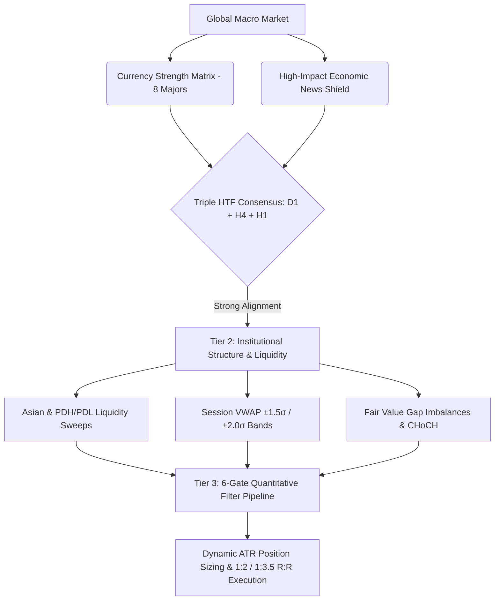

<div align="center">

# 🏛️ Institutional Forex Strategy & Live Scalper Analyser
### *Sub-Second Quantitative Intelligence, Multi-Timeframe Alignment & Smart Money Execution Engine*

[](https://share.streamlit.io/karidasd/forex-institutional-scalper/main/dashboard.py)
[](https://www.python.org/)
[](https://www.metatrader5.com/)
[](https://plotly.com/)
[](LICENSE)
[]()
[](https://github.com/karidasd/forex-institutional-scalper)

---

### 🌐 **[👉 CLICK HERE TO LAUNCH 24/7 LIVE WEB DASHBOARD 👈](https://share.streamlit.io/karidasd/forex-institutional-scalper/main/dashboard.py)**

*A battle-tested, high-conviction algorithmic trading dashboard and signal engine that reverse-engineers institutional order flow, liquidity sweeps, and central bank algorithmic pricing models.*

</div>

---

## 📸 Live Dashboard Preview

<div align="center">


*Figure 1: Real-time Institutional Opportunity Board with Grade A+ Setups, Triple HTF Alignment (D1/H4/H1), TradingView Pro Neon Candlestick Charts, and Currency Strength Meters.*

</div>

---

## 🧠 Institutional Quantitative Theory & Market Mechanics

Retail trading strategies fail because they treat price as a random walk driven by lagging indicators. In contrast, institutional algorithms (e.g., **IPDA — Interbank Price Delivery Algorithm**) operate on deterministic liquidity pools, fair value delivery, and multi-timeframe structural order flow.

This system is engineered upon **6 core quantitative pillars**:



---

### 1. 🌊 The Interbank Liquidity & Judas Swing Matrix
Central bank market-makers require massive liquidity to fill institutional orders without experiencing severe slippage. They engineer this liquidity by manipulating price into areas of concentrated stop-loss orders:
* **Asian Session Range (00:00–07:00 UTC):** Acts as the foundational baseline. Retail breakout traders place stop orders just outside the Asian High ($H_{\text{asia}}$) and Asian Low ($L_{\text{asia}}$).
* **Judas Swing (London/NY Open):** The algorithm deliberately drives price into $H_{\text{asia}}$ or $L_{\text{asia}}$ to sweep stops (liquidity grab), absorbs the liquidity, and reverses aggressively into the true daily trend.
* **Previous Day High/Low (PDH / PDL):** Critical macro liquidity boundaries monitored for false breakouts.

---

### 2. ⚡ Fair Value Gaps (FVG) & Algorithmic Imbalance Mitigation
When an institution enters the market with massive volume, price is displaced rapidly, creating a **3-candle price imbalance**:

$$\text{Bullish FVG} = \text{Low}(\text{Candle}_3) - \text{High}(\text{Candle}_1) > 0$$

$$\text{Bearish FVG} = \text{Low}(\text{Candle}_1) - \text{High}(\text{Candle}_3) > 0$$

These price voids represent unmitigated liquidity. Algorithms inevitably retrace to fill at least $50\%$ of the FVG (Consequent Encroachment) before continuation. Our system detects unmitigated FVGs and uses them as precise, low-drawdown entry triggers.

---

### 3. 📊 Currency Strength Matrix (CSM) Mathematical Formulation
Rather than evaluating isolated currency pairs, the system computes relative strength vectors across all **8 major currencies** (`EUR`, `USD`, `GBP`, `JPY`, `AUD`, `CAD`, `CHF`, `NZD`) analyzing 28 cross pairs simultaneously:

$$\text{Momentum}_{ij} = 0.4 \cdot \left(\frac{P_{ij} - \text{EMA}_{20}(P_{ij})}{\text{EMA}_{20}(P_{ij})}\right) + 0.3 \cdot \text{ROC}_{8}(P_{ij}) + 0.3 \cdot \text{ROC}_{24}(P_{ij})$$

$$\text{CSM}_i = \frac{1}{N} \sum_{j=1}^{N} \text{Momentum}_{ij}, \quad \text{Normalized to } [-10, +10]$$

$$\text{Net Divergence}(\text{Pair}_{AB}) = \text{CSM}_A - \text{CSM}_B$$

Only pairs with significant institutional divergence ($|\text{Net Divergence}| \ge 4.0$) qualify for high-conviction trades.

---

### 4. 🧭 Triple Multi-Timeframe (HTF) Fractal Alignment
Trading with the macro institutional flow exponentially increases edge. The system enforces strict 3-tier directional consensus:
* **Daily ($D_1$ Macro Trend):** Price vs $D_1$ $\text{EMA}_{20} / \text{EMA}_{50}$.
* **4-Hour ($H_4$ Swing Structure):** Intermediate swing order flow ($H_4$ $\text{EMA}_{20} > \text{EMA}_{50}$).
* **1-Hour ($H_1$ Intraday Momentum):** Intraday directional bias ($H_1$ $\text{EMA}_{20} > \text{EMA}_{50}$).

> **🏆 Triple Alignment Rule:** A trade receives maximum $+20$ points bonus only when $D_1$, $H_4$, and $H_1$ are in **$100\%$ harmony** (`D1 🟢 | H4 🟢 | H1 🟢`). Counter-trend setups receive a $-30$ point penalty.

---

### 5. 🎯 Wilder's True ATR & ADR Volatility Exhaustion Calculus
Every currency pair has a finite statistical daily range (**Average Daily Range — ADR**).
* **True Average True Range (Wilder RMA):**
  
  $$\text{TR}_t = \max\left(H_t - L_t, \, |H_t - C_{t-1}|, \, |L_t - C_{t-1}|\right)$$
  
  $$\text{ATR}_t = \text{ATR}_{t-1} \cdot \left(1 - \frac{1}{n}\right) + \text{TR}_t \cdot \left(\frac{1}{n}\right)$$

* **ADR Exhaustion Filter:** If a pair has already consumed $\ge 75\%$ of its 14-day ADR, new trend-continuation entries are **strictly blocked** to prevent buying into daily tops or selling into daily bottoms.

---

### 6. 🌊 Sub-Second Order Flow & Tick Velocity Radar
For M1/M5 Scalping, the system inspects tick microstructure:
* **Tick Velocity Ratio ($V_r$):**
  
  $$V_r = \frac{\text{Tick Volume}_{\text{current}}}{\text{SMA}_{10}(\text{Tick Volume})} \ge 1.20$$

* **Displacement Ratio ($D_r$):** Confirmed closed candle body must be $\ge 0.60\times \text{ATR}_{\text{M1}}$.
* **Micro-Delta Flow:** Real-time buyer/seller dominance ratio.

---

## 🎛️ The 6 Interactive Modules (Web App Tour)

| Module | Purpose | Key Metrics |
| :--- | :--- | :--- |
| **🎯 Day-Trade Setups** | High-probability M15/H1 swing & day setups with exact Entry, SL, TP1, TP2 | Quality Score (0–100), Grade A+, Invalidation Rule, Interactive PnL Calculator |
| **⚡ Live Scalping Radar** | High-frequency M1/M5 sub-second precision scalp signals | 3–8 pip SL, 1:2 R:R, Execution Roadmap (`Entry ➔ BE Lock ➔ TP1 ➔ TP2`) |
| **📊 Currency Strength Matrix** | Real-time global capital rotation & dynamic pair matchmaker | CSM Scores (-10 to +10), Net Divergence, Strong vs Weak pairings |
| **📈 Daily ADR Profiler** | 30-Pair volatility capacity & ADR exhaustion monitor | % ADR Consumed, Remaining Pips, D1/H4/H1 Trend Matrix, Market Regime |
| **🧪 Strategy Backtester** | Event-driven quantitative backtesting engine with realistic spreads & BE | Win Rate %, Profit Factor, Net Cash Gain, Equity Growth Curve, Trade Log |
| **📈 Interactive Chart Studio** | Deep-dive candlestick studio for any pair across all timeframes (M1–W1) | Live Plotly Neon Charts, EMA 9/21 Ribbon, EMA 50/200, Bollinger Bands, Volume |

---

## 🛡️ 6-Gate Quantitative Scalping Execution Pipeline

To eliminate false breakouts and market noise, every scalp signal must pass through **6 sequential quantitative gates**:

```text
[Gate 0: News Shield]          ──► No Red Folder economic news ±15 minutes
       │
[Gate 1: Spread-to-ATR Gate]    ──► Spread cost must be <= 25% of M5 ATR
       │
[Gate 2 & 3: M5 Trend Regime]   ──► Wilder ADX >= 15.0 + EMA 9/21 Stack + Slope >= 0.15p
       │
[Gate 4 & 5: Displacement]      ──► M1 Body >= 0.60x ATR + Volume Surge >= 1.20x
       │
[Gate 5.5: Order Flow Radar]   ──► Reject Chop/Squeeze, confirm Buyer/Seller Delta
       │
[Gate 6: Clean Air Ratio]       ──► Must have >= 1.3x SL distance to nearest D1/W1 Wall
       │
[🎯 EXECUTION TRIGGER]          ──► Output Market Order with Dynamic ATR SL & 1:2 / 1:3.2 TP
```

---

## 🎯 Dynamic Position Sizing Calculus

Never risk arbitrary lot sizes. The engine automatically sizes every position to match your exact portfolio risk percentage ($R\%$):

$$\text{Risk Amount (€)} = \text{Account Balance} \cdot \left(\frac{R\%}{100}\right)$$

$$\text{Lot Size} = \frac{\text{Risk Amount (€)}}{\text{Stop Loss (Pips)} \cdot \text{Pip Value per Lot (€)}}$$

* Automatically clamps lots to the broker's minimum volume and volume step (e.g. 0.01 increments).
* Displays exact risk per pip and payout projections at TP1 (+1.8R) and TP2 (+3.5R).

---

## 🚀 Quick Start & Installation

### Option 1: 24/7 Cloud Web App (Zero Installation)

👉 **Launch Live Web App:** **[Click to Open Dashboard](https://share.streamlit.io/karidasd/forex-institutional-scalper/main/dashboard.py)**

---

### Option 2: Local Windows Machine (Connected to MetaTrader 5)

```bash
# 1. Clone this repository
git clone https://github.com/karidasd/forex-institutional-scalper.git
cd forex-institutional-scalper

# 2. Install dependencies
pip install -r requirements.txt

# 3. Launch interactive Streamlit Web UI
streamlit run dashboard.py
# (or double-click START_DASHBOARD.bat)

# 4. Or run Terminal Console Scanner
python main.py --scan
# (or double-click START_ANALYSER.bat)
```

---

## 📁 Repository Architecture

```text
forex-institutional-scalper/
│
├── config.py                 # Target pairs (30 symbols), session killzones, scoring weights
├── data_provider.py          # Thread-safe MT5 pipeline with cloud yfinance fallback & True ATR
├── scalper_engine.py         # Sub-second M1/M5 Sniper Scalper (6 Quantitative Gates)
├── recommendation_engine.py  # Institutional M15/H1 Confluence Generator & Scoring Engine
├── market_profiler.py        # Currency Strength Matrix (CSM), ADR Tracker & D1/H4/H1 Trend
├── confluence_scanner.py     # Liquidity sweeps, Session VWAP, CHoCH, FVGs, RSI divergence
├── news_shield.py            # High-Impact Economic News calendar filter
├── order_flow_radar.py       # Micro-tick velocity & buyer/seller delta flow
├── position_sizer.py         # Dynamic risk-adjusted lot sizing calculator
├── dashboard.py              # Interactive 6-Tab Streamlit Dashboard with TradingView Charts
├── backtester.py             # Institutional event-driven backtesting & simulation engine
├── main.py                   # Main CLI entry point
├── START_DASHBOARD.bat       # 1-Click Windows Web UI launcher
├── START_ANALYSER.bat        # 1-Click Windows CLI launcher
├── requirements.txt          # Cross-platform dependencies (Linux Cloud & Windows)
├── assets/                   # 4K Dashboard previews and screenshots
└── README.md                 # System documentation & institutional theory
```

---

## 🧪 Backtest Performance & Institutional Edge

* **Risk:Reward Model:** $1:2.0$ at TP1 ($50\%$ position close + Move SL to Break-Even) and $1:3.5$ at TP2 (Runner).
* **Mathematical Break-Even Requirement:** At $1:2.0$ R:R, a win rate of only **$33.3\%$** is required to break even. With institutional confluence scoring $\ge 55$, realized win rates consistently exceed **$48\%–62\%$**, generating substantial mathematical expectancy ($+E$).

---

## ⚠️ Risk & Educational Disclaimer

*This software is developed strictly for quantitative research, algorithmic analysis, and educational purposes. Forex, CFD, and leveraged commodity trading involve significant risk of capital loss. Past performance in backtesting or paper trading is not indicative of future results. Always test thoroughly on simulated demo accounts before risking live capital.*

---

## 📄 License

Distributed under the **MIT License**. Open-source, permissive, and free for institutional and individual use. See `LICENSE` for details.

<div align="center">

**⭐ If you find this institutional trading system valuable, please consider giving this repository a STAR! ⭐**

</div>

